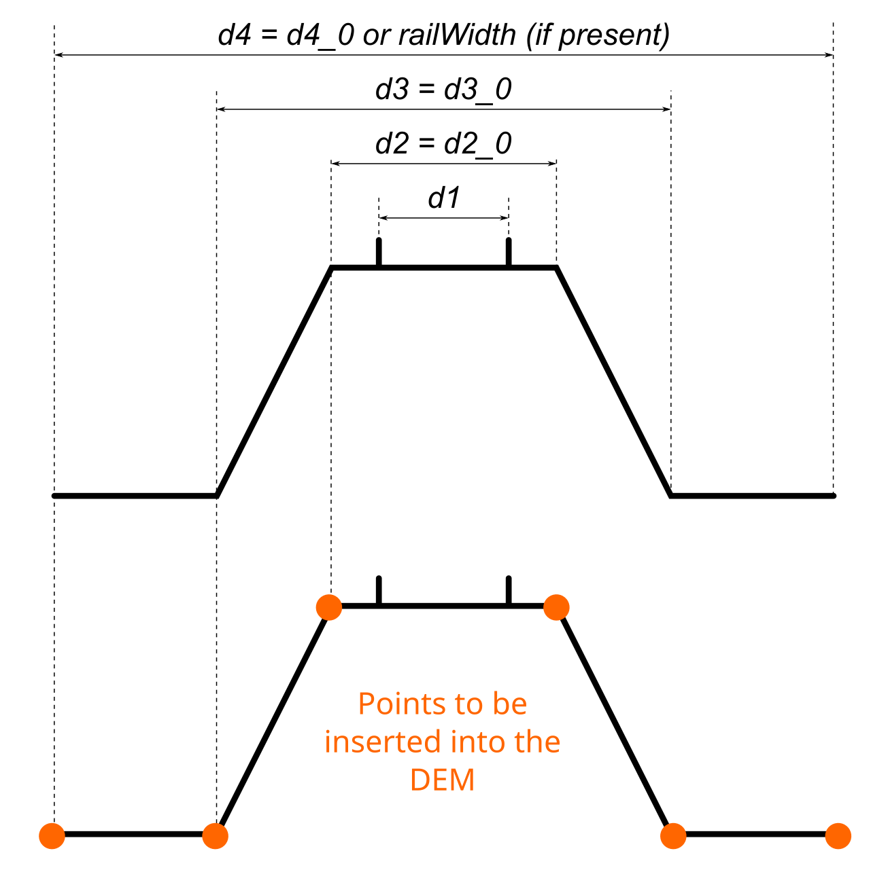

.. DO NOT UPDATE THIS FILE!!
.. This document has been automatically generated with noisemodelling-scripts/src/main/java/org/noise_planet/noisemodelling/autodoc/GenerateFunctionsDocs.java

Enrich DEM with rail
====================

Enrich DEM with railways

Overview
--------

➡️ Insert altimetric points coming from railways into the input DEM.
This script works with two input layers:

* Digital Elevation Model (DEM) to be enriched

* Railways

And seven parameters:

* Railways width (railWidth): Name of the column where the total railway platform width is stored (Optional). If the column is present, it overrides the total width (d4) defined in the railway platform data file

* Rail platform (platformColumn): Name of column where the platform identifier is stored (Optional). Default value = "PLATFORM"

* Simplify tolerance (simplifyTolerance): Distance (in meters) used by the ST_Simplify function to simplify the rail geometries before computing the buffers (Optional). Default value = 0.5m

* Densify distance (densifyDistance): Distance (in meters) between consecutive points created by the ST_Densify function on the buffered rail geometries (Optional). Default value = 5m

* Input SRID (inputSRID): SRID of the input tables (Optional)

* Output suffix (outputsuffix): suffix applied at the end of the resulting table name (Optional). If not specified, "ENRICHED" is applied

* Railway platform data file (railwayPlatformDataFile): URL of the railway platform data file in CNOSSOS format (json). By default, the file provided with NoiseModelling is used (Optional)

The railway platform geometry (section widths and platform heights) is read from the PLATFORM column of the input railways table and resolved against the railway platform data file. In the schema below, orange points will be inserted into the DEM. d2, d3 and d4 (the section half-widths) are taken from the platform definition (d2_0, d3_0 and d4_0 respectively), and d4 can be overridden by the railWidth column when it is present in the railways table. The inserted points are lowered below the top-of-rail elevation using the platform heights (h2 = rail height above the ballast, h1 = ballast shoulder height):

* d2 = d2_0, points at the rail elevation

* d3 = d3_0, points lowered by h2 (ballast shoulder level)

* d4 = d4_0, or railWidth if the railWidth column is present, points lowered by h2 + h1 (surrounding terrain)

Arguments
---------

Mandatory inputs
~~~~~~~~~~~~~~~~

``inputDEM`` — *Input DEM table*
   Name of the input DEM table to be enriched

   Type: ``String``

``inputRail`` — *Input railways table*
   Name of the input railways table

   Type: ``String``

Optional inputs
~~~~~~~~~~~~~~~

``densifyDistance`` — *Densify distance*
   Distance (in meters) between consecutive points created by the ST_Densify function on the buffered rail geometries.

   Type: ``double``

   Default: ``5``

``inputSRID`` — *Input SRID*
   🌍 SRID of the input tables.  🛠 If not specified, the SRID from DEM layer is applied. If DEM has no SRID, 0 is applied

   Type: ``Integer``

``outputsuffix`` — *Output suffix*
   Suffix applied at the end of the resulting table name  🛠 If not specified, "ENRICHED" is applied

   Type: ``String``

   Default: ``ENRICHED``

``platformColumn`` — *Platform column*
   Name of column where the platform identifier is stored. The value is resolved against the railway platform data file.

   Type: ``String``

   Default: ``PLATFORM``

``railWidth`` — *Railways width*
   Name of column where the total railways platform width is stored. When present, it overrides the total width (d4) defined in the railway platform data file.

   Type: ``String``

``railwayPlatformDataFile`` — *Railway platform data file*
   URL of the railway platform data file in CNOSSOS format (json). By default, the file provided with NoiseModelling is used.

   Type: ``String``

``simplifyTolerance`` — *Simplify tolerance*
   Distance (in meters) used by the ST_Simplify function to simplify the rail geometries before computing the buffers.

   Type: ``double``

   Default: ``0.5``

Output
------

``result`` — *Result output string*
   This type of result does not allow the blocks to be linked together.

   Type: ``String``

