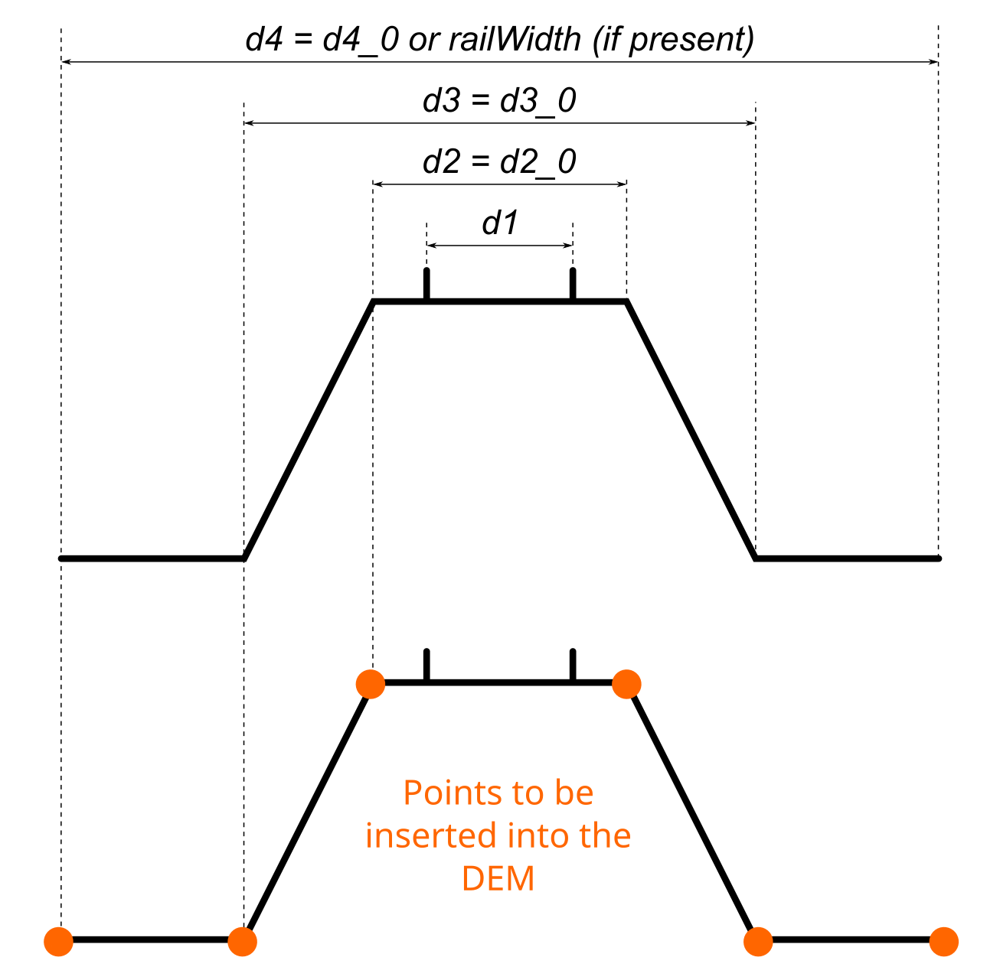

.. DO NOT UPDATE THIS FILE!!
.. This document has been automatically generated with noisemodelling-scripts/src/main/java/org/noise_planet/noisemodelling/autodoc/GenerateFunctionsDocs.java

Enrich Landcover with rail
==========================

Enrich Landcover with railways

Overview
--------

➡️ Insert rail ground surfaces into the input LANDCOVER.
This script works with two input layers:

* Landcover to be enriched

* Railways

And four parameters:

* Railways width (railWidth): Name of the column where the total railway platform width is stored (Optional). If the column is present, it overrides the total width (d4) defined in the railway platform data file

* Rail platform (platformColumn): Name of column where the platform identifier is stored (Optional). Default value = "PLATFORM"

* Input SRID (inputSRID): SRID of the input tables (Optional)

* Output suffix (outputsuffix): suffix applied at the end of the resulting table name (Optional). If not specified, "ENRICHED" is applied

* Railway platform data file (railwayPlatformDataFile): URL of the railway platform data file in CNOSSOS format (json). By default, the file provided with NoiseModelling is used (Optional)

The railway platform geometry (track gauge, ground factors, heights and section widths) is read from the PLATFORM column of the input railways table and resolved against the railway platform data file. In the schema below, the points (in orange) will be inserted into the DEM. d2, d3 and d4 (the section half-widths) are taken from the platform definition (d2_0, d3_0 and d4_0 respectively), and d4 can be overridden by the railWidth column when it is present in the railways table:

* d2 = d2_0

* d3 = d3_0

* d4 = d4_0, or railWidth if the railWidth column is present

Arguments
---------

Mandatory inputs
~~~~~~~~~~~~~~~~

``gColumn`` — *G column*
   Ground absorption coefficient (G) column name

   Type: ``String``

``inputLandcover`` — *Input landcover table*
   Name of the input landcover table

   Type: ``String``

``inputRail`` — *Input railways table*
   Name of the input railways table

   Type: ``String``

Optional inputs
~~~~~~~~~~~~~~~

``inputSRID`` — *Input SRID*
   🌍 SRID of the input tables.  🛠 If not specified, the SRID from DEM layer is applied. If DEM has no SRID, 0 is applied

   Type: ``Integer``

``outputsuffix`` — *Output suffix*
   Suffix applied at the end of the resulting table name

   Type: ``String``

   Default: ``ENRICHED``

``platformColumn`` — *Platform column*
   Name of column where the platform identifier is stored. The value is resolved against the railway platform data file.

   Type: ``String``

   Default: ``PLATFORM``

``railWidth`` — *Railways width*
   Name of column where the total railways platform width is stored. When present, it overrides the total width (d4) defined in the railway platform data file.

   Type: ``String``

``railwayPlatformDataFile`` — *Railway platform data file*
   URL of the railway platform data file in CNOSSOS format (json). By default, the file provided with NoiseModelling is used.

   Type: ``String``

Output
------

``result`` — *Result output string*
   This type of result does not allow the blocks to be linked together.

   Type: ``String``

